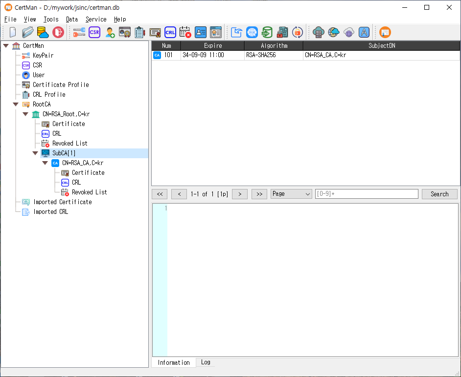

# CertMan

CertMan is a desktop application for managing X.509 certificates and related PKI data. It helps users generate and inspect key pairs, certificate signing requests (CSRs), certificates, and certificate revocation lists (CRLs), and organize those records in a database. It also includes tools for certificate profiles, revocation workflows, importing and exporting data, and running selected PKI services.

## What you can do

### Manage PKI records

CertMan stores and organizes PKI information in a database. A typical workflow is to create or open a database, generate or import a key pair, define a certificate profile, create a CSR, and then issue, import, inspect, export, renew, or revoke certificates as needed. Certificate and CRL profiles let you configure the contents of generated artifacts for different use cases.

The application includes record management for key pairs, requests, certificates, CRLs, users, signers, and related CA and profile information. It can also import data or retrieve data through supported URIs. Available record types and operations can depend on the installed edition.

### Create keys, requests, certificates, and CRLs

The **Tools** menu provides commands for generating key pairs, making certificate requests, registering users, creating certificate and CRL profiles, issuing certificates, creating CRLs, revoking certificates, and opening CA and profile managers. Supported cryptographic algorithms depend on the application build and license; the source includes RSA, ECDSA, DSA, EdDSA, SM2, ML-DSA, and SLH-DSA paths.

### Exchange and protect data

The **Data** menu includes import, retrieval from a URI, LDAP publishing, and private-key password tools. Some actions require a licensed edition. The application also supports integration settings for services such as LDAP, KMIP, OCSP, CMP, TSP, REG, and SCEP, depending on edition and configuration.

### Run PKI services

The **Service** menu contains TSP, OCSP, CA, and ACME service dialogs. These let an operator configure a listener, select the relevant signing or TLS certificates and keys, and start or stop the service. Service controls may be unavailable in the unlicensed edition. The separate **Server** menu provides additional server tools in editions that include them.

## Suggested getting-started workflow

1. Install the package for your operating system and launch CertMan.
2. Use **File > New** to create a database, or **File > Open** to open an existing one.
3. Generate a key pair from **Tools > New keypair**, or import an existing key and certificate.
4. Create a certificate profile and make a CSR, or use an existing CA and profile to issue a certificate.
5. Review the resulting records in the main window, then export or publish them as required.
6. For a service workflow, configure its certificates, keys, profile, and listener in the appropriate **Service** dialog before starting it.

