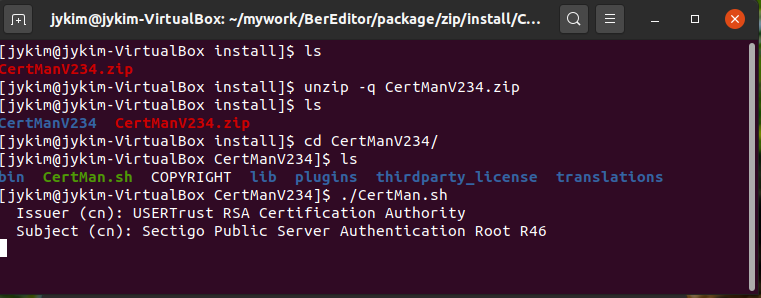

# CertMan Linux Installation and Startup Guide

This guide explains how to extract the Linux ZIP package and start CertMan with the included `CertMan.sh` script.

> **Version note:** The filename `CertManV234.zip` and screenshots below are from CertMan 2.3.4. Package filenames, folder contents, startup steps, and screens may differ between releases. Check the [download and update history](https://jykim74.github.io/software/2024/03/08/CertManUpdate.html) for the version you are using.

## 1. Download the ZIP package

[Download CertMan for Linux 64-bit](https://jykim74.github.io/zip/CertManV234.zip)

Open a terminal in the directory where the package was downloaded. The commands below assume the ZIP file is in the current directory.



## 2. Extract the package

Run the following commands to extract the ZIP file and enter the extracted directory:

```bash
unzip -q CertManV234.zip
cd CertManV234
```

The extracted folder contains items such as `bin`, `lib`, `plugins`, `translations`, and `thirdparty_license`, as well as the `CertMan.sh` startup script. Use `ls` to confirm that the files were extracted.

## 3. Start CertMan

From the extracted CertMan directory, run:

```bash
./CertMan.sh
```

The script may prompt for **Issuer (cn)** and **Subject (cn)** values in the terminal. Enter the issuer and subject Common Names (CN) for the certificate. The values shown in the screenshot are examples:

```text
Issuer (cn): USERTrust RSA Certification Authority
Subject (cn): Sectigo Public Server Authentication Root R46
```

The prompts and behavior may vary by release and configuration. If the script does not start, first confirm that you are in the extracted CertMan directory and that `CertMan.sh` is present.

## 4. Prepare a database

When CertMan opens, select **File > New** to create a database or **File > Open** to open an existing one. Choose a storage location and password, and keep the password and database backup safe. For key-pair, CSR, and certificate workflows, see the [CertMan Basic Usage Guide](CERTMAN_BASIC_EN.md).

## References

- [CertMan Linux 64-bit package](https://jykim74.github.io/zip/CertManV234.zip)
- [CertMan downloads and update history](https://jykim74.github.io/software/2024/03/08/CertManUpdate.html)
- [CertMan Basic Usage Guide](CERTMAN_BASIC_EN.md)
