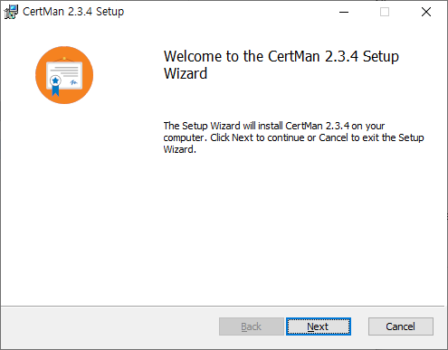
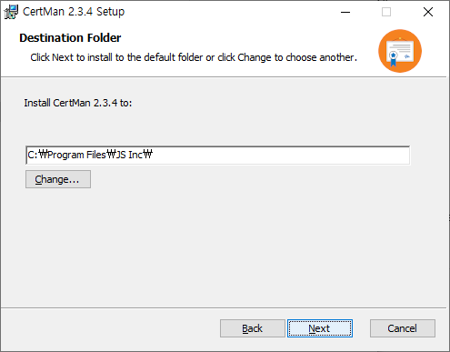
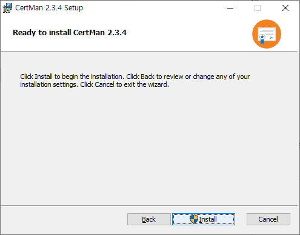
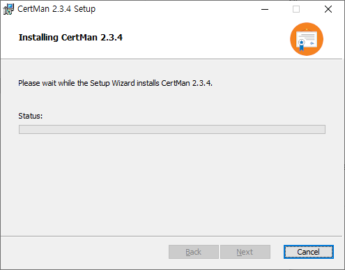
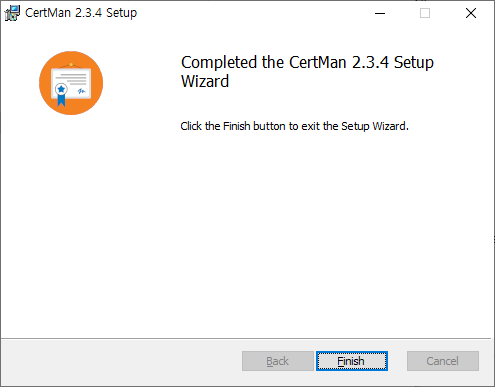

# CertMan Windows Installation Guide

This guide explains how to install CertMan using the Windows 64-bit installer. The screenshots below show the CertMan 2.3.4 Setup Wizard.

> **Version note:** The version and filename shown here are examples. Installer filenames, screens, installation paths, and options may change between releases. Check the [download and update history](https://jykim74.github.io/software/2024/03/08/CertManUpdate.html) for the version you are installing.

## 1. Download and start the installer

[Download the CertMan Windows 64-bit installer](https://jykim74.github.io/msi/CertMan-enV234.msi)

Double-click the downloaded MSI file to start the Setup Wizard. Confirm the product name and version on the welcome screen, then click **Next**.

## 2. Choose the installation folder

Review the destination folder. Click **Next** to use the default location. To install to a different location, click **Change...**, choose a folder, and then click **Next**.

## 3. Start installation

Review the installation settings and click **Install** to begin. Click **Back** if you need to change an earlier setting.

If Windows User Account Control (UAC) appears, review the installer prompt and approve it to continue. Administrator approval may be required.

## 4. Wait for installation to finish

Wait while the Setup Wizard installs CertMan. Do not close the wizard during installation.

## 5. Finish and launch CertMan

When the completion screen appears, click **Finish** to close the Setup Wizard.

Find **CertMan** in the Start menu and launch it. On first launch, select **File > New** to create a database or **File > Open** to open an existing one. See the [CertMan Basic Usage Guide](CERTMAN_BASIC_EN.md) for common workflows.

## Troubleshooting

- If the Setup Wizard does not start, confirm that the MSI download is complete and try again.
- If you see an installation permission error, check whether your Windows account has permission to install applications. Managed computers may require administrator approval.
- If CertMan does not start after installation, note the error message, Windows version, and installer version.
- To uninstall CertMan, open Windows **Settings > Apps > Installed apps** and select CertMan. Database files are managed separately from the application, so back up any data you need before uninstalling.

## References

- [CertMan Windows 64-bit installer](https://jykim74.github.io/msi/CertMan-enV234.msi)
- [CertMan downloads and update history](https://jykim74.github.io/software/2024/03/08/CertManUpdate.html)
- [CertMan Basic Usage Guide](CERTMAN_BASIC_EN.md)
