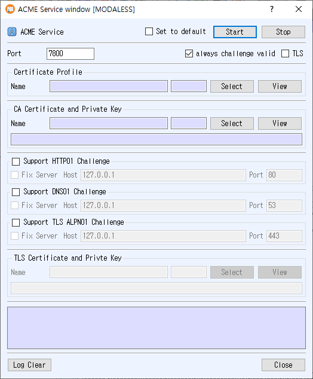

# ACME Service Manual

The ACME Service dialog runs an ACME certificate enrollment service. Configure a certificate profile, CA signing certificate/private key, and at least one supported challenge method before starting the service.

## Open the dialog

Choose **Service > ACME Service** from the main window.

## Configure the service

1. Enter the ACME listener **Port**. The initial value is the application's ACME service port.
2. In **Certificate Profile**, click **Select** to choose the profile used for issued certificates. Use **View** to inspect it.
3. In **CA Certificate and Private Key**, click **Select** to choose the CA signing certificate and its private key. Use **View** to inspect the certificate.
4. Choose one or more challenge methods by enabling their sections:
   - **Support HTTP01 Challenge**: configure the challenge **Host** and **Port**. The initial host is `127.0.0.1` and port is `80`.
   - **Support DNS01 Challenge**: configure the DNS challenge **Host** and **Port**. The initial host is `127.0.0.1` and port is `53`.
   - **Support TLS ALPN01 Challenge**: configure the challenge **Host** and **Port**. The initial host is `127.0.0.1` and port is `443`.
5. For a challenge method, check **Fix Server** to provide a fixed challenge server endpoint. When enabled, the Host and Port fields are disabled; the configured endpoint is passed to the service.
6. **always challenge valid** is enabled by default. Leave it checked to use this behavior, or clear it to disable it.
7. To enable TLS on the ACME listener, check **TLS** and select a TLS certificate/private key in the enabled **TLS Certificate and Private Key** section. Use **View** to inspect the certificate.
8. Optionally check **Set to default** to save these settings for the next time the dialog opens.
9. Click **Start**. The Start button turns green when the ACME service starts; runtime messages appear in the log.

The certificate profile and CA certificate/private key are required. Enable the challenge methods that your ACME clients will use. If TLS is enabled for the ACME listener, its TLS certificate and private key must be available. The application reports errors for an empty port, unavailable certificate or key records, unsupported PKCS#11 TLS certificates, or a server that fails to start.

## Controls

- **Stop** stops the ACME service.
- **Log Clear** clears the displayed log.
- **Close** closes the dialog.
- **Set to default** saves the listener port, TLS setting, selected profile and certificates, challenge settings, and **always challenge valid** choice. If unchecked when the service starts, the saved default is cleared.

