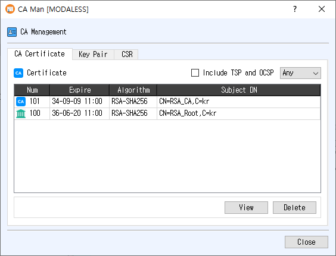

# CA Manager Dialog Guide

This guide explains the **CA Man** dialog, titled **CA Management**. Open it from **Tools > CA Manager** (`Shift+F11`). The dialog lets you browse and manage CA certificates, key pairs, and certificate signing requests (CSRs), or select one of these items when another workflow requests it.

## Management mode

In management mode, use the **CA Certificate**, **Key Pair**, and **CSR** tabs to view or delete database records. Select a row, then click **View** or **Delete**. The same actions are available from the table's right-click menu; double-clicking a row opens its details.

### CA Certificate tab

| Control / column | Purpose |
|---|---|
| **Include TSP and OCSP** | Switch the list to signer certificates used for TSP/OCSP, in addition to the issuer certificate list. |
| **Algorithm filter** | Show **Any**, RSA, ECDSA, DSA, EdDSA, SM2, ML-DSA, or SLH-DSA certificates. |
| **Num** | Database certificate record number. |
| **Expire** | Certificate expiration time. |
| **Algorithm** | Certificate signature algorithm. |
| **Subject DN** | Certificate subject distinguished name. |
| **View** | Open certificate details. |
| **Delete** | Ask for confirmation, then delete the selected certificate record. |

### Key Pair tab

| Control / column | Purpose |
|---|---|
| **Status filter** | Show key pairs with **NotUsed** or **Used** status. |
| **Algorithm filter** | Filter by **Any**, RSA, ECDSA, DSA, EdDSA, SM2, ML-DSA, or SLH-DSA. |
| **Num** | Database key-pair record number. |
| **RegTime** | Key-pair registration time. |
| **Algorithm** | Key-pair algorithm. |
| **Name** | Key-pair name. |
| **View** | Open private-key information for the selected key pair. |
| **Delete** | Ask for confirmation, then delete the selected key-pair record. |

### CSR tab

| Control / column | Purpose |
|---|---|
| **Status filter** | Show CSRs with **NotUsed** or **Used** status. |
| **Algorithm filter** | Filter by **Any**, RSA, ECDSA, DSA, EdDSA, SM2, ML-DSA, or SLH-DSA. |
| **Num** | CSR record number. |
| **RegTime** | CSR registration time. |
| **Subject DN** | Subject distinguished name from the request. |
| **Name** | CSR name. |
| **View** | Open CSR details. |
| **Delete** | Ask for confirmation, then delete the selected CSR record. |

Changing a filter reloads that tab's list. Table rows cannot be edited directly.

## Selection mode

Other CertMan dialogs use CA Manager as a picker for a CA certificate, key pair, or CSR. In selection mode, only the relevant tab is enabled, management buttons are hidden, and **OK** is shown. Select a row and click **OK**, or double-click the row, to return the selected database record number to the calling dialog. Use **Close** to exit without choosing an item.

## Notes

- The dialog requires an open database.
- Delete actions ask for confirmation and remove the selected database record. Check dependencies before deleting certificates or key pairs used by other records.
- The **Include TSP and OCSP** checkbox affects the certificate list; it is not an algorithm filter.

## Related implementation

This guide is based on `images/ca_man_dlg.png`, `src/CertMan/ca_man_dlg.ui`, `src/CertMan/ca_man_dlg.h`, and `src/CertMan/ca_man_dlg.cpp`.
