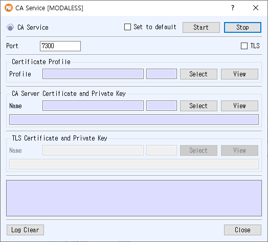

# CA Service Manual

The CA Service dialog starts a Certificate Authority (CA) service. It uses a certificate profile to process requests and a CA certificate/private key to issue certificates. TLS for the listener is optional.

## Open the dialog

Choose **Service > CA Service** from the main window.

## Configure the service

1. Enter the listener **Port**.
2. In **Certificate Profile**, click **Select** to choose the profile used to issue certificates. The selected profile number and name appear in the fields; click **View** to inspect it.
3. In **CA Server Certificate and Private Key**, click **Select** to choose the CA signing certificate and associated private key. Use **View** to inspect the certificate.
4. To enable encrypted transport, check **TLS**. Select the TLS certificate and private key in the enabled **TLS Certificate and Private Key** section, and use **View** to inspect the certificate.
5. Optionally check **Set to default** to reuse these settings the next time the dialog opens.
6. Click **Start**. The Start button turns green when the CA service is running. Runtime messages appear in the log.

A certificate profile and CA certificate/private key are required. If TLS is enabled, its certificate/private key must also be available. The application reports an error when the port is empty, a selected record or key cannot be loaded, or the service fails to start. TLS certificates backed by PKCS#11 are not supported by this dialog.

## Controls

- **Stop** stops the CA service.
- **Log Clear** clears the displayed log.
- **Close** closes the dialog.
- **Set to default** saves the port, TLS option, profile number, and CA/TLS certificate numbers. If unchecked when the service starts, the saved default is cleared.

