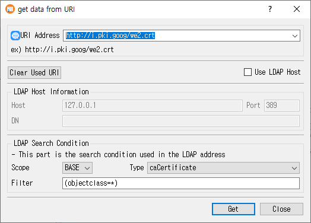

# Get Data from URI Dialog Guide

This guide explains the **get data from URI** dialog. Open it from **Data > Get data from URI** (`Ctrl+Alt+U`). The dialog retrieves a certificate or CRL from an HTTP(S) or LDAP location and imports it into CertMan.

## Retrieve an object from a URI

1. Enter or choose a value in **URI Address**. HTTP and HTTPS URLs are supported; LDAP URIs can include a search DN, scope, filter, and attribute.
2. For an LDAP URI, review the **Scope**, **Type**, and **Filter** search conditions as needed.
3. Alternatively, select **Use LDAP Host** and enter the host, port, and DN, then set the LDAP **Type** and **Filter**.
4. Click **Get** to retrieve and import the object. Click **Close** to exit.

CertMan recognizes the returned data as a certificate or CRL and imports it into the corresponding imported list. Successful non-manual URI addresses are saved in the recent URI list.

## URI Address mode

| Control | Purpose |
|---|---|
| **URI Address** | Editable address/history field. HTTP and HTTPS are fetched over HTTP; LDAP addresses are queried using the LDAP search parameters. `URL=` and `URI=` prefixes are accepted and removed before retrieval. |
| **Clear Used URI** | Clear the locally stored recent URI history. |
| **Use LDAP Host** | Switch from URI mode to a form where host, port, and DN are entered separately. |

The URI history is stored in application settings, not in the current database. The most recent successful URI is placed at the top. Manually entered LDAP host requests are not added to that history.

## LDAP Host mode and search conditions

| Field | Purpose |
|---|---|
| **Host** | LDAP server hostname or IP address. Defaults to `127.0.0.1`. |
| **Port** | LDAP port. Defaults to `389` if left blank. |
| **DN** | Base distinguished name for the LDAP request. Required in this mode. |
| **Scope** | LDAP URI search scope. The current UI offers **BASE**. |
| **Type** | LDAP certificate/CRL attribute: `caCertificate`, `signCertificate`, `userCertificate`, `certificateRevocationList`, or `authorityRevocationList`. |
| **Filter** | LDAP search filter. Defaults to `(objectclass=*)`. |

LDAP access uses an anonymous bind in this dialog. In manual **Use LDAP Host** mode, host and DN are required; the filter and selected attribute are used for the search. The default scope is BASE.

## Imported records

- Certificates are stored in the imported certificate list. LDAP `caCertificate` marks the imported certificate as a CA certificate.
- CRLs are stored in the imported CRL list. CertMan retains CRL update dates, signature algorithm, and distribution point information when available.
- Failed network, LDAP, or object parsing operations display a retrieval error and do not report success.

## Related implementation

This guide is based on `images/get_uri_dlg.png`, `src/CertMan/get_uri_dlg.ui`, `src/CertMan/get_uri_dlg.h`, `src/CertMan/get_uri_dlg.cpp`, and the **Data > Get data from URI** action in `src/CertMan/mainwindow.cpp`.
