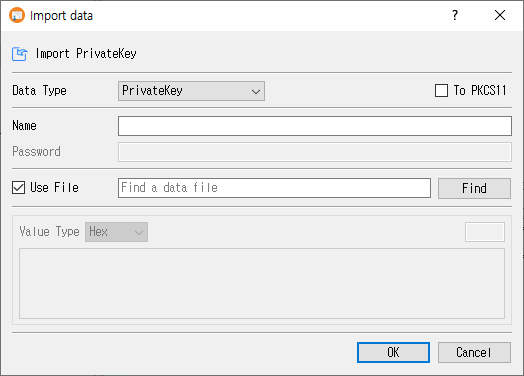

# Import Data Dialog Guide

This guide explains the **Import data** dialog. Open it from **Data > Import data** (`Ctrl+Alt+I`). A database connection is required.

## Import data

1. Select a **Data Type**.
2. Enter a **Name** when importing a private key, CSR, or PFX-related key pair.
3. For an encrypted private key or PFX, enter its **Password**.
4. Keep **Use File** selected and choose a file with **Find**, or clear it and paste data into the value editor.
5. When pasting, choose **Value Type** (Hex or Base64) and enter the encoded data.
6. Optionally select **To PKCS11** or **To KMS** when importing a private key, or **To KMS** for a certificate when supported.
7. Click **OK** to import, or **Cancel** to close.

On success, CertMan adds the imported object to the relevant list and reports **Import was successful**. The **Name** field is enabled for key, CSR, and PFX imports, but the source does not require a non-empty name.

## Data types

| Data Type | Purpose and result |
|---|---|
| **PrivateKey** | Import an unencrypted private key and create a key-pair record with **NotUsed** status. |
| **Encrypted PrivateKey** | Decrypt with **Password**, then import the private key as a key pair. |
| **Request(CSR)** | Parse a CSR and add it to the Request list using the entered name. |
| **Certificate** | Parse and add a certificate to the imported certificate list. |
| **CRL** | Parse and add a CRL to the imported CRL list. |
| **PFX** | Decode a PKCS#12/PFX bundle using **Password**, then import its certificate and private key. The key pair is marked **Used**. |

The password field is enabled for **Encrypted PrivateKey** and **PFX**. The name field is disabled for **Certificate** and **CRL**.

## Source selection and value format

| Control | Purpose |
|---|---|
| **Use File** | Read data from a selected file. This is selected by default. |
| **Find** | Select an input file. The file filter is adjusted for the chosen data type. |
| **Value Type** | Select **Hex** or **Base64** for pasted input. |
| Value editor | Paste the encoded object when **Use File** is cleared. The adjacent length field shows the calculated data length. |

CertMan also accepts a file dragged onto the dialog. With **Use File** enabled, the dropped path fills the file field; with it disabled, file bytes are decoded into the selected text format in the editor.

## Key storage options

- **To PKCS11** is available only for private-key imports and when the PKCS#11 provider is configured and loaded. The import implementation supports RSA, ECDSA, and DSA for PKCS#11 storage.
- **To KMS** is shown in Pro. It can store supported private keys or certificates through the configured KMIP/KMS service.
- Importing a CSR or CRL to KMS is not supported by this dialog. The dialog reports this if **To KMS** is selected for either type.
- In the unlicensed version, only RSA private keys can be imported.
- When CertMan private-key encryption is enabled, imported internal private keys are encrypted before they are saved.

## Related implementation

This guide is based on `images/import_dlg.png`, `src/CertMan/import_dlg.ui`, `src/CertMan/import_dlg.h`, `src/CertMan/import_dlg.cpp`, and the **Data > Import data** action in `src/CertMan/mainwindow.cpp`.
