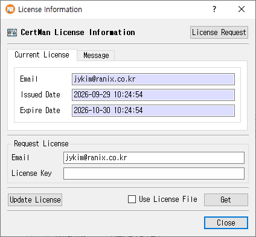

# License Information Manual

The License Information dialog displays the current CertMan license and provides controls to request, load, update, or remove license information.

## Open the dialog

Choose **License Information** from the main window.

## Review license details

On the **Current License** tab, review the license **Email**, **Issued Date**, and **Expire Date**. The **Message** tab displays the license-related notice. Select **Do stop showing this message for the time being** to suppress that notice temporarily.

## Load or request a license

1. In **Request License**, enter the account **Email** and **License Key**.
2. Click **Get** to retrieve and validate the license. If you already have a license file, check **Use License File**; the button changes to **Find**, which opens a file picker.
3. To request a license, click **License Request** to open the license registration page in a browser. For a free license, enter an email address and click **Free License**, then confirm the request.
4. After a successful license change, the dialog offers to restart the application so the change can take effect.

License files are validated before being applied. The online retrieval or free-license request requires the corresponding license service to be supported by the application build.

## Update or remove license information

- Click **Update License** to renew the current license, when one is installed. The application reports an error if no license is present or the update cannot be completed.
- Click **Remove** to remove invalid saved license information after confirming the prompt.
- Click **Close** to close the dialog.

