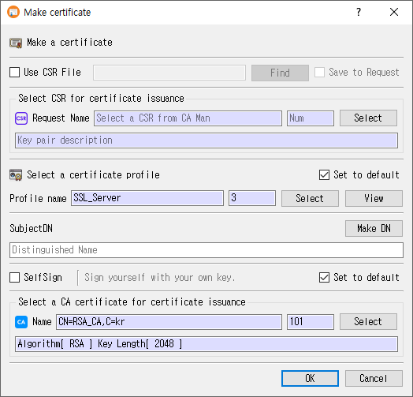

# Make Certificate Dialog Guide

This guide explains the **Make certificate** dialog, which issues a certificate from a certificate signing request (CSR) and a certificate profile. Open it from **Tools > Make Certificate** (`Shift+F8`). A database connection is required.

## Issue a certificate

1. Select a CSR from the database, or check **Use CSR File** and click **Find** to load a CSR file.
2. Select a **certificate profile** and review its settings with **View** if needed.
3. Confirm or edit the **Subject DN**. Use **Make DN** to compose a distinguished name.
4. Choose whether to issue a self-signed certificate or select the CA certificate that will issue it.
5. In Pro, optionally enter user information to register along with the certificate.
6. Click **OK** to issue and save the certificate. Click **Cancel** to exit without issuing.

The CSR, certificate profile, and (for CA-signed issuance) issuer certificate are required. For file-based CSR input, **Save to Request** optionally stores the imported CSR in the database as part of issuance. CertMan checks the CSR signature before issuing. On success, the certificate is saved and the relevant certificate tree/list is refreshed.

## CSR selection

| Field or control | Purpose |
|---|---|
| **Use CSR File** | Use a CSR file instead of a CSR record already in the database. This disables the database CSR selector. |
| CSR file path / **Find** | Choose a BER/DER CSR file. The dialog reads the CSR and displays its subject DN when available. |
| **Save to Request** | When using a CSR file, also save that CSR in the database's Request list. |
| **Request Name / Num** | Read-only name and record number of the selected database CSR. |
| **Select** | Opens the CA Manager to select a stored CSR. The associated key-pair description is shown below. |

Self-signing is not available when **Use CSR File** is selected. A stored request's CSR signature must verify successfully before certificate issuance continues.

## Certificate profile and subject

| Field or control | Purpose |
|---|---|
| **Profile name / Num** | Read-only name and record number of the selected certificate profile. |
| **Select** | Choose a certificate profile from the Profile Manager. |
| **View** | Inspect the selected profile. |
| **Set to default** | Remember this certificate profile for the next use of the dialog. |
| **Subject DN** | Subject distinguished name to place in the issued certificate. A profile using the CSR DN template takes the request's subject DN. |
| **Make DN** | Opens the DN editor with the current value. |

The selected profile supplies certificate version, signature hash, validity period, and extensions. Template placeholders in the subject DN and applicable extension values can be replaced using the Pro **User Information** fields.

## Self-signing and CA issuer

- **SelfSign** issues a self-signed certificate using the key associated with the selected stored CSR. It cannot be used with an external CSR file.
- For CA-signed issuance, select a CA certificate using **Select** in the issuer section. The issuer name, record number, and associated key-pair description are displayed.
- **Set to default** beside the issuer controls remembers the selected issuer (or the self-sign option) for future use.
- If the selected CA certificate is expired or revoked, CertMan asks whether to continue.

The CA certificate's associated private key signs the new certificate. The application can use locally stored keys and configured PKCS#11 or KMIP keys.

## User Information (Pro)

The **User Information** group is shown in Pro. **UserName**, **SSN**, and **Email** are optional. If a UserName is provided, CertMan stores a user record with the issued certificate. These values can also fill user-related placeholders in the certificate subject DN and applicable extensions.

## Important checks

- The CSR signature must verify.
- If the CSR public-key algorithm differs from the signing key algorithm, CertMan asks whether to continue.
- SM2 signing uses the SM3 hash. If the selected profile uses another hash, CertMan may ask whether to change it; an incompatible SM3 selection for other key algorithms is rejected.
- If the CA certificate is expired or revoked, issuance requires confirmation.

## Related implementation

This guide is based on `images/make_cert_dlg.png`, `src/CertMan/make_cert_dlg.ui`, `src/CertMan/make_cert_dlg.h`, `src/CertMan/make_cert_dlg.cpp`, and the **Tools > Make Certificate** action in `src/CertMan/mainwindow.cpp`.
