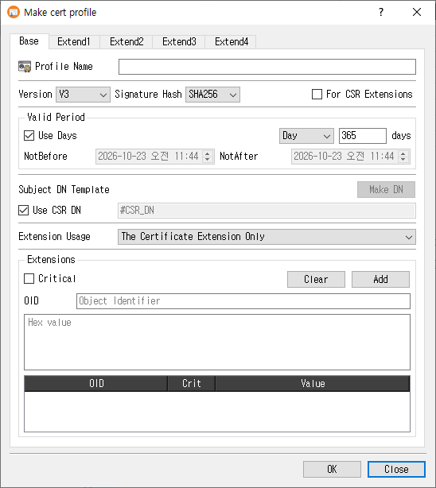

# Make Certificate Profile Dialog Guide

This guide explains the **Make cert profile** dialog. Open it from **Tools > Make Cert Profile**. A database connection is required. The dialog creates reusable certificate profiles; existing profiles can also be edited, copied, or viewed from the Profile Manager.

## Create a profile

1. On the **Base** tab, enter a **Profile Name**.
2. Choose whether the profile is for a certificate or for **CSR Extensions**.
3. For a certificate profile, configure the version, signature hash, validity period, subject DN template, and extension usage.
4. Use the **Extend1** through **Extend4** tabs to configure the extensions needed by certificates or CSRs. Each extension has its own controls; select **Critical** when that extension should be marked critical.
5. Click **OK** to save the profile. Click **Close** to exit without saving.

The profile name is required. For certificate profiles, a subject DN template is also required unless **Use CSR DN** is selected. On success, CertMan saves the profile and its configured extensions, refreshes the Certificate Profile list, and displays **Certificate profile created**.

## Base tab

| Field or control | Purpose |
|---|---|
| **Profile Name** | Required name for the profile. |
| **Version** | Certificate version. This control is disabled for a profile marked **For CSR Extensions**. |
| **Signature Hash** | Default signature digest used by the profile where applicable. Disabled for CSR extension profiles. |
| **For CSR Extensions** | Creates a profile intended for CSR extensions. Certificate-specific controls such as version, validity, subject DN, and extension usage are disabled. |
| **Valid Period** | For certificate profiles, choose either a relative duration or explicit dates. |
| **Use Days** | When selected, specify a duration and unit (**Day**, **Month**, or **Year**). New profiles default to 365 days. |
| **NotBefore / NotAfter** | When **Use Days** is cleared, set explicit start and end date/time values. |
| **Subject DN Template** | Subject name template used for certificates. Click **Make DN** to compose a DN. |
| **Use CSR DN** | Use the subject DN from the certificate request. When selected, the DN template field is disabled. |
| **Extension Usage** | Choose where extensions are used: certificate only, CSR only, or both with an order preference. |
| **Extensions** | Add custom extensions by entering an OID and hexadecimal value. Use **Critical** to mark the custom extension critical; **Add** inserts it into the table and **Clear** removes table entries. |

For a new certificate profile, CertMan defaults to V3, the configured default hash, **Use CSR DN**, and a 365-day validity period. The extension usage default is **The Certificate Extension Only**.

## Extension tabs

The four extension tabs group the supported X.509 extensions. Enter the required values in an extension's controls, then use **Add** to add table-based values. **Clear** removes table entries where available. Criticality is configured separately for each extension group.

| Tab | Extension groups |
|---|---|
| **Extend1** | Key Usage, Certificate Policies, Subject Key Identifier (SKI), and Authority Key Identifier (AKI). |
| **Extend2** | Extended Key Usage (EKU), CRL Distribution Points (CRLDP), and Authority Information Access (AIA). |
| **Extend3** | Basic Constraints, Subject Alternative Name (SAN), and Issuer Alternative Name (IAN). |
| **Extend4** | Policy Constraints, Policy Mappings, and Name Constraints. |

Common value types include usage selections, OIDs, URIs, and typed alternative names. Some groups provide additional fields such as CA/path length, policy counters, or name-constraint distances. Configure only the extensions required by your certificate or request policy.

## Edit, copy, and view

- **Edit** loads the saved profile and its extensions. The profile type cannot be changed while editing.
- **Copy** loads an existing profile's settings with `_Copy` appended to its name, allowing you to save a separate profile.
- **View** opens the profile in read-only mode.

## Notes

- Certificate and CSR extension profiles share the extension tabs, but the CSR profile type disables certificate-specific base settings.
- Explicit validity dates are checked to ensure the **NotBefore** value is not too early. Choose appropriate validity values for your certificate policy.
- Profile extension contents are stored with the profile in the connected database.

## Related implementation

This guide is based on `images/make_cert_profile_dlg.png`, `src/CertMan/make_cert_profile_dlg.ui`, `src/CertMan/make_cert_profile_dlg.h`, `src/CertMan/make_cert_profile_dlg.cpp`, and the **Tools > Make Cert Profile** action in `src/CertMan/mainwindow.cpp`.
