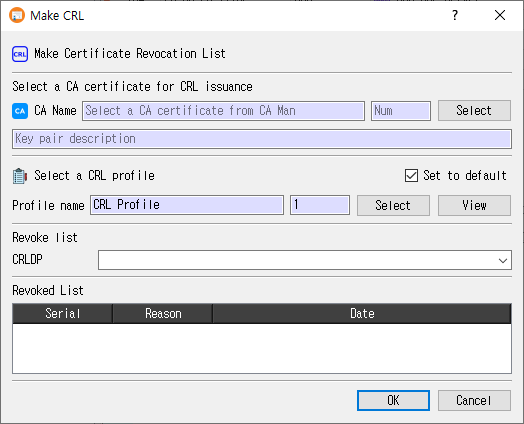

# Make CRL Dialog Guide

This guide explains the **Make CRL** dialog, which creates a Certificate Revocation List (CRL) for a selected CA certificate. Open it from **Tools > Make CRL** (`Shift+F9`). A database connection is required.

## Generate a CRL

1. Select a **CA certificate** with **Select**. CertMan displays the CA name, record number, and associated key-pair description.
2. Select a **CRL profile**. Use **View** to review it if needed.
3. Choose a **CRLDP** value. The list is populated from the selected CA certificate and can also be edited.
4. Review the **Revoked List**. It shows revocations for the selected CA and CRL distribution point.
5. Click **OK** to generate and save the CRL. Click **Cancel** to close without generating it.

The CA certificate and CRL profile are required. If the CA certificate is expired or revoked, CertMan asks whether to continue. On success, the generated CRL is saved in the database and the CRL list for the selected CA is refreshed.

## CA certificate

| Field or control | Purpose |
|---|---|
| **CA Name / Num** | Read-only subject name and record number of the selected issuer certificate. |
| **Select** | Opens the CA Manager to choose a CA certificate. |
| **Key pair description** | Read-only description of the private key associated with the CA certificate. The associated key signs the CRL. |

The selected certificate determines the issuer and the revocation records considered for the CRL. If the certificate is expired or revoked, generation requires confirmation.

## CRL profile

| Field or control | Purpose |
|---|---|
| **Profile name / Num** | Read-only name and record number of the selected CRL profile. |
| **Select** | Opens the Profile Manager to choose a CRL profile. |
| **View** | Opens the selected CRL profile for review. |
| **Set to default** | Remember the selected CRL profile for the next use of the dialog. A previously saved default is selected automatically. |

The profile provides the CRL version, signature hash, update period, and extensions. If the issuer key is SM2, CertMan requires SM3 or asks whether to change the profile hash to SM3. SM3 is rejected for unsupported issuer key algorithms.

## Revocation list and CRLDP

| Field or control | Purpose |
|---|---|
| **CRLDP** | Distribution point filter for revoked certificates included in this CRL. The dropdown is populated from the issuer certificate's CRL distribution points and is editable. |
| **Revoked List** | Read-only list of revoked certificates matching the selected CA and CRLDP, with **Serial**, **Reason**, and **Date** columns. |

Changing the CA certificate or CRLDP refreshes the revoked list. The resulting CRL uses the chosen CRLDP value and includes the matching revocation entries.

## After generation

CertMan creates and parses the CRL, stores its issuer, update times, signature algorithm, CRLDP, and encoded data in the database, then refreshes the selected CA's CRL list. The application displays **CRL has been generated**. A profile marked **Auto (Use Sequence)** for the CRL Number extension receives the next database sequence value.

## Related implementation

This guide is based on `images/make_crl_dlg.png`, `src/CertMan/make_crl_dlg.ui`, `src/CertMan/make_crl_dlg.h`, `src/CertMan/make_crl_dlg.cpp`, and the **Tools > Make CRL** action in `src/CertMan/mainwindow.cpp`.
