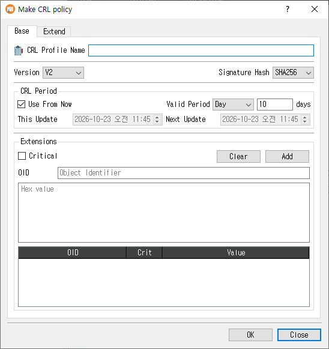

# Make CRL Profile Dialog Guide

This guide explains the **Make CRL policy** dialog, which creates reusable Certificate Revocation List (CRL) profiles. Open it from **Tools > Make CRL Profile** (`Shift+F7`). A database connection is required. Existing profiles can also be edited, copied, or viewed from the Profile Manager.

## Create a CRL profile

1. On the **Base** tab, enter a **CRL Profile Name**.
2. Select the CRL **Version** and **Signature Hash**.
3. Set the CRL update period. Keep **Use From Now** selected to use a relative period, or clear it to specify explicit update dates.
4. Open the **Extend** tab and enable the extension groups you need. Configure each extension's options and criticality.
5. Click **OK** to save the profile. Click **Close** to leave without saving.

The profile name is required. On success, CertMan stores the profile and its extension settings in the connected database, refreshes the CRL Profile list, and displays **CRL profile created**.

## Base tab

| Field or control | Purpose |
|---|---|
| **CRL Profile Name** | Required name for this profile. |
| **Version** | CRL version, either V1 or V2. The default for a new profile is V2. |
| **Signature Hash** | Selects the digest used for the CRL signature. New profiles default to the application's configured hash. |
| **CRL Period** | Controls the **This Update** and **Next Update** values. |
| **Use From Now** | When selected, set **Valid Period** to a number of days, months, or years from the current time. New profiles default to 10 days. |
| **This Update / Next Update** | When **Use From Now** is cleared, enter explicit date and time values. |

The unit dropdown offers **Day**, **Month**, and **Year**. The adjacent label changes to match the selected unit.

## Extend tab

Each extension group is checkable. Enable the group to include that extension in CRLs created from this profile. Use its **Critical** checkbox to mark the extension critical where applicable.

| Extension | Controls and behavior |
|---|---|
| **CRL Number** | Choose **Auto (Use Sequence)** to use the application sequence, or clear it and enter a fixed value in hexadecimal. The automatic sequence option is selected by default. |
| **Authority Key Identifier** | Add issuer certificate information by selecting **Certificate Issuer** and/or **Certificate Serial**. |
| **Issuing Distribution Point** | Select the distribution point type (the UI currently provides **URI**), enter its value, then click **Add**. Duplicate values are rejected. **Clear** removes the listed values. |
| **Issuer Alternative Name** | Choose a value type (**URI**, **email**, or **DNS**), enter a value, and click **Add**. Duplicate values are rejected. **Clear** removes the listed values. |
| **Extensions** | Add a custom extension by entering its **OID** and hexadecimal **Value**, choosing **Critical** if needed, and clicking **Add**. An OID can be added only once. **Clear** removes all listed custom extensions. |

For the table-based Issuing Distribution Point, Issuer Alternative Name, and custom extension entries, you can also select a row and use its context menu to delete that row.

## Edit, copy, and view

- **Edit** loads the saved profile and its extension settings. Saving replaces the profile's stored extension list with the current configuration.
- **Copy** loads an existing profile's settings and appends `_Copy` to the name so it can be saved as a separate profile.
- **View** opens the profile in read-only mode; the **OK** button is hidden.

## Notes

- The explicit **This Update** value is checked to ensure it is not too early. Choose update times and intervals that match your CRL publication policy.
- Custom extension values are entered as hexadecimal data. The form requires both an OID and a value.
- Profile settings are saved to the currently connected database.

## Related implementation

This guide is based on `images/make_crl_profile_dlg.png`, `src/CertMan/make_crl_profile_dlg.ui`, `src/CertMan/make_crl_profile_dlg.h`, `src/CertMan/make_crl_profile_dlg.cpp`, and the **Tools > Make CRL Profile** action in `src/CertMan/mainwindow.cpp`.
