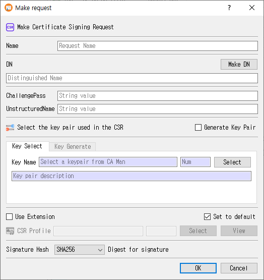

# Make Request Dialog Guide

This guide explains the **Make request** dialog used to create a certificate signing request (CSR). Open it from **Tools > Make Request** (`Shift+F2`). A database connection is required.

## Create a CSR

1. Enter a **Name** for the request.
2. Enter the subject **DN** (Distinguished Name), or click **Make DN** to compose it with the DN editor.
3. Optionally enter **ChallengePass** and **UnstructuredName** values.
4. Choose how to provide the signing key:
   - Keep **Generate Key Pair** unchecked and use **Key Select** to choose an existing key pair.
   - Check **Generate Key Pair** to create a new key pair in this dialog, then use **Key Generate** to set its name, algorithm, and parameters.
5. Optionally check **Use Extension** and select a CSR profile. Use **View** to inspect the selected profile.
6. Choose the **Signature Hash** when the selected key algorithm supports a separate hash.
7. Click **OK** to create and save the CSR. Click **Cancel** to close without submitting it.

The request name and DN are required. If extensions are enabled, a CSR profile must be selected. If using an existing key, select a key pair first. On success, CertMan saves the request, marks the associated key pair as used, refreshes the Request list, and displays **CSR created**.

## Request information

| Field or control | Purpose |
|---|---|
| **Name** | Required name for the CSR record. |
| **DN** | Required subject distinguished name encoded in the request. |
| **Make DN** | Opens the DN editor, retaining the current DN as its starting value. |
| **ChallengePass** | Optional challenge password attribute. |
| **UnstructuredName** | Optional unstructured name attribute. |
| **Signature Hash** | Selects the digest used for the CSR signature when applicable. The initial value comes from the application's default hash setting. |

## Select an existing key pair

When **Generate Key Pair** is unchecked, the **Key Select** tab is used:

| Field or control | Purpose |
|---|---|
| **Key Name** | Read-only name of the selected key pair. |
| **Num** | Read-only database record number for the key pair. |
| **Select** | Opens the CA Manager selection dialog. Choose a key pair and confirm. |
| **Key pair description** | Read-only description of the selected key pair. |

The key's algorithm and parameters are taken from the selected database record. For PKCS#11 or KMIP keys, the corresponding configured provider is used to create the CSR signature.

## Generate a new key pair

Check **Generate Key Pair** to switch to the **Key Generate** tab. The existing-key tab becomes unavailable until the checkbox is cleared.

| Field or control | Purpose |
|---|---|
| **Key Name** | Required database name for the newly generated key pair. CertMan may suggest the request name followed by `_keyPair`. |
| **Mechanism** | Select RSA, ECDSA, DSA, EdDSA, or SM2. The **PQC** row contains ML-DSA and SLH-DSA. |
| **Public Exponent** | RSA public exponent, initially `65537`; disabled for algorithms that do not use it. |
| **Key Length / parameter dropdown** | Select the mechanism-specific key size, curve, or parameter set. Defaults to RSA 2048 unless changed by a saved key-generation preference. |
| **To PKCS#11** | Generate the key through a configured PKCS#11 token/HSM when supported and available. |
| **To KMIP** | Generate through KMIP. This control is shown in Pro and depends on the configured KMIP provider. |

The available key parameters follow the choices in the New keypair dialog: RSA sizes 1024, 2048, 3072, 4096, and 8192; DSA sizes 1024, 2048, and 3072; supported named curves for ECDSA; Ed25519/Ed448; SM2; ML-DSA-44/65/87; and the SLH-DSA SHA2/SHAKE parameter sets. Exact availability can depend on the selected storage provider and edition.

## CSR profile and extensions

- **Use Extension** enables the CSR profile controls.
- **CSR Profile** displays the selected profile name and record number. Click **Select** to choose a profile; click **View** to inspect it.
- The **Set to default** checkbox beside the extension controls saves the extension/profile selection for later use. The last selection is restored when the dialog is opened again.
- When a profile includes Subject Key Identifier or Authority Key Identifier extensions, CertMan derives the key identifier from the public key while building the request.

## Signature hash behavior

The hash dropdown is disabled for EdDSA, ML-DSA, and SLH-DSA, whose signature algorithms determine the digest behavior. Selecting SM2 sets the hash to **SM3**. When an existing key pair is selected, the dialog adjusts hash availability based on that key.

## Edition and configuration notes

- In the unlicensed version, RSA is selected and the other mechanism choices are disabled.
- **To PKCS#11** is disabled when the PKCS#11 context is unavailable. PKCS#11 use also requires valid settings and an accessible session.
- **To KMIP** is hidden outside Pro. It requires KMIP configuration.
- Some algorithm/storage combinations are restricted by the dialog. For example, PKCS#11 selection disables SM2 and the PQC mechanisms in the key-generation controls.
- For internally stored keys, CertMan uses its private-key password feature when that feature is enabled.

## Related implementation

This guide is based on `images/make_req_dlg.png`, `src/CertMan/make_req_dlg.ui`, `src/CertMan/make_req_dlg.h`, `src/CertMan/make_req_dlg.cpp`, and the **Tools > Make Request** action in `src/CertMan/mainwindow.cpp`.
