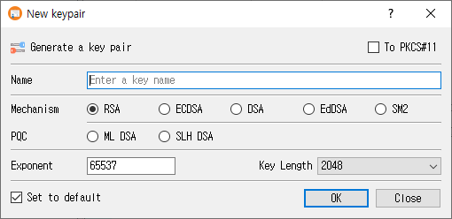

# New Key Pair Dialog Guide

This guide explains the **New keypair** dialog in CertMan. The dialog is opened from **Tools > New keypair** (shortcut: `Shift+F1`). A database must be connected before you can open it.

## Create a key pair

1. Enter a unique, recognizable value in **Name**. The name is required.
2. Select a **Mechanism**. Choose one of the standard algorithms, or a post-quantum algorithm in the **PQC** row.
3. Select the parameter or key length from the dropdown. The available choices depend on the selected mechanism.
4. For RSA, review or change **Exponent**. It defaults to `65537`. This field is disabled for algorithms that do not use an RSA exponent.
5. Optionally select a key storage destination, if available and configured.
6. Select **Set to default** if you want this algorithm and parameter selection to be preselected the next time the dialog opens.
7. Click **OK** to generate and save the key pair. Click **Close** to leave without generating it.

After successful generation, CertMan stores the key pair in the connected database, refreshes the KeyPair list, and reports **Key pair generated**. If generation fails, the dialog displays an error.

## Fields and options

| Control | Purpose |
|---|---|
| **Name** | Database name for the key pair. It cannot be empty. |
| **Mechanism** | Select RSA, ECDSA, DSA, EdDSA, or SM2. |
| **PQC** | Select ML-DSA or SLH-DSA, the post-quantum algorithm choices. |
| **Key Length / parameter dropdown** | Choose the algorithm-specific size, curve, or parameter set. The label changes to match the selected algorithm. |
| **Exponent** | RSA public exponent; the initial value is `65537`. |
| **To PKCS#11** | Generate using a configured PKCS#11 token or HSM. This option is unavailable if the PKCS#11 provider is not loaded. |
| **To KMIP** | Generate through KMIP. This option is shown in Pro and requires suitable KMIP configuration. |
| **Set to default** | Save the selected algorithm, parameter, and HSM choice as the dialog's next default. |
| **OK** | Generate and save the key pair. |
| **Close** | Close the dialog without submitting the form. |

## Algorithm parameters

The parameter dropdown is populated for the selected mechanism:

| Mechanism | Choices provided by the application |
|---|---|
| **RSA** | Key sizes: 1024, 2048, 3072, 4096, or 8192 bits. |
| **ECDSA** | Named elliptic curves, including `prime256v1`, `secp256k1`, `secp384r1`, and `secp521r1`. The full list is available in the dropdown. |
| **DSA** | Key sizes: 1024, 2048, or 3072 bits. |
| **EdDSA** | Ed25519 or Ed448. |
| **SM2** | SM2 parameter. |
| **ML-DSA** | ML-DSA-44, ML-DSA-65, or ML-DSA-87. |
| **SLH-DSA** | SHA2 or SHAKE parameter sets at 128-, 192-, or 256-bit security levels, with `s` and `f` variants. |

## Availability and storage notes

- The unlicensed version selects RSA and disables the other mechanism choices.
- The **To PKCS#11** option is enabled only when the PKCS#11 context is available. PKCS#11 settings and a usable token/session are also required when generating.
- **To KMIP** appears in Pro. KMIP supports the mechanisms implemented by the application; some mechanism choices are disabled while KMIP is selected.
- ML-DSA and SLH-DSA use the application's software key generation path even if PKCS#11 is selected; they are not generated as PKCS#11 keys by this dialog implementation.
- Key generation requires a connected database. Internal private keys are encrypted when CertMan's private-key password feature is enabled.

## Related implementation

This guide is based on `images/new_key_dlg.png`, `src/CertMan/new_key_dlg.ui`, `src/CertMan/new_key_dlg.h`, `src/CertMan/new_key_dlg.cpp`, and the **Tools > New keypair** action in `src/CertMan/mainwindow.cpp`.
