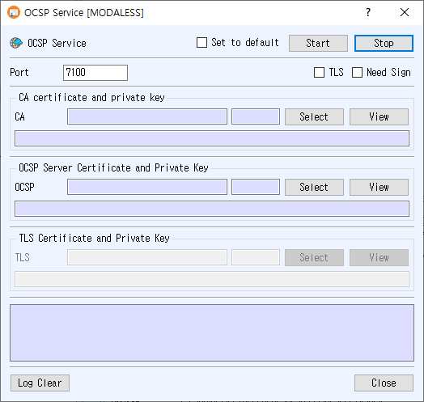

# OCSP Service Manual

The OCSP Service dialog runs an Online Certificate Status Protocol (OCSP) responder. Configure its CA certificate, OCSP signing certificate, and listener settings before starting it.

## Open the dialog

Choose **Service > OCSP Service** from the main window.

## Configure the service

1. Enter the listener **Port**.
2. In **CA certificate and private key**, click **Select** to choose the CA certificate used by the responder. Use **View** to inspect it.
3. In **OCSP Server Certificate and Private Key**, click **Select** to choose the certificate and associated private key used to sign OCSP responses. Use **View** to inspect it.
4. Optionally check **Need Sign** to enable the responder's response-signing option.
5. To enable encrypted transport, check **TLS**. Then select the certificate and private key in **TLS Certificate and Private Key**. Use **View** to inspect the selected TLS certificate.
6. Optionally check **Set to default** to save the current configuration for the next time the dialog opens.
7. Click **Start**. The button turns green when the server starts, and runtime messages appear in the log.

The CA certificate and OCSP signing certificate/private key must be available. When TLS is enabled, its certificate and private key must also be available. The application reports errors for missing ports, unavailable certificate or key records, unsupported PKCS#11 TLS certificates, or a listener that fails to start.

## Controls

- **Stop** stops the OCSP responder.
- **Log Clear** clears the displayed log.
- **Close** closes the dialog.
- **Set to default** saves the port, TLS and Need Sign options, and selected CA, OCSP, and TLS certificate numbers. If unchecked when the service starts, the saved default is cleared.

