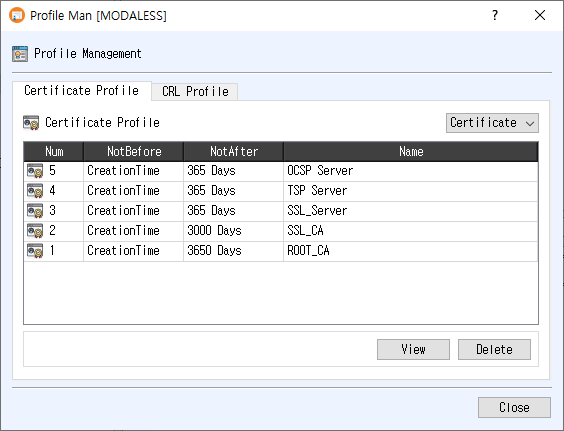

# Profile Manager Manual

The Profile Manager displays the certificate, CSR, and CRL profiles saved in the current CertMan database. In management mode, you can inspect a profile or delete it. Create or modify profiles through the corresponding profile creation tools.

## Open the dialog

Choose **Tools > Profile Manager** from the main window. The manager opens as a modeless window, so you can return to the main window while it remains open.

## Certificate Profile tab

The **Certificate Profile** tab lists certificate and CSR profiles. Use the selector at the upper right to switch between **Certificate** and **CSR** profiles. The table shows:

- **Num**: profile record number.
- **NotBefore** and **NotAfter**: the configured validity period.
- **Name**: profile name.

Select a row, then click **View** to open the profile details. You can also double-click a row or right-click the table and choose **View**. To remove the selected profile, click **Delete** or use the right-click **Delete** command, then confirm the prompt. The list refreshes after a successful deletion.

## CRL Profile tab

The **CRL Profile** tab lists saved CRL profiles. The table shows the profile number, **ThisUpdate**, **NextUpdate**, and **Name**. Select a row and click **View** to inspect its details; double-clicking or using the right-click **View** command also opens the profile. To delete a profile, click **Delete** or choose it from the right-click menu and confirm.

## Notes

- The tables do not allow direct editing. **View** opens a read-only profile details window.
- Deletion requires confirmation and removes the selected profile record from the current database.
- If no row is selected, the manager displays a warning when you request **View** or **Delete**.
- Click **Close** to close the manager.

