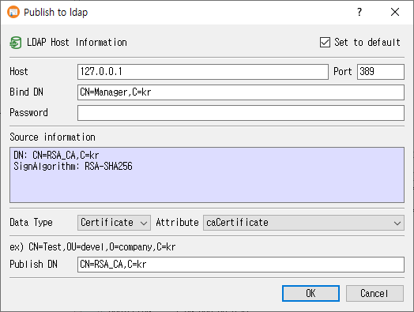

# Publish to LDAP Dialog Guide

This guide explains the **Publish to ldap** dialog. Open it from **Data > Publish to LDAP** (`Ctrl+Alt+L`) for a selected certificate or CRL. The command requires a licensed version and an open database.

## Publish an object

1. Enter the LDAP **Host**, **Port**, **Bind DN**, and **Password**.
2. Choose **Data Type** (**Certificate** or **CRL**).
3. Choose an LDAP **Attribute** appropriate to the data type.
4. Review or edit **Publish DN**. It is initially derived from the certificate subject or, for a CRL, its LDAP distribution point when available.
5. Optionally keep **Set to default** selected to remember the host, port, and Bind DN.
6. Click **OK** to bind to the LDAP server, create any missing parent entries, and publish the object. Click **Cancel** to exit.

Host, Bind DN, password, and Publish DN are required. Port defaults to `389` when blank. CertMan displays a success message after publishing.

## Fields and choices

| Field | Purpose |
|---|---|
| **Set to default** | Save the host, port, and Bind DN in application settings for future use. The password is not included in these saved defaults. |
| **Host** | LDAP server hostname or IP address. Defaults to `localhost` when no saved host exists. |
| **Port** | LDAP server port; defaults to `389`. |
| **Bind DN** | Distinguished name used to authenticate to LDAP. |
| **Password** | Password for the Bind DN; displayed as masked text. |
| **Source information** | Read-only summary of the selected certificate or CRL. |
| **Data Type** | Select Certificate or CRL. |
| **Attribute** | Certificate: `caCertificate`, `signCertificate`, or `userCertificate`. CRL: `certificateRevocationList` or `authorityRevocationList`. |
| **Publish DN** | LDAP distinguished name where the object is published. |

For a certificate, the initial Publish DN is derived from its subject DN. For a CRL, an LDAP CRLDP value is used as the initial value when present. You can edit the DN before publishing.

## Notes

- The LDAP bind and publish operation modifies the target directory. Confirm that the selected attribute and DN match the directory schema and intended destination.
- The dialog creates missing parent entries before publishing the selected certificate or CRL.
- Saved defaults include connection host, port, and Bind DN, but do not store the password or Publish DN.

## Related implementation

This guide is based on `images/pub_ldap_dlg.png`, `src/CertMan/pub_ldap_dlg.ui`, `src/CertMan/pub_ldap_dlg.h`, `src/CertMan/pub_ldap_dlg.cpp`, and the **Data > Publish to LDAP** action in `src/CertMan/mainwindow.cpp`.
