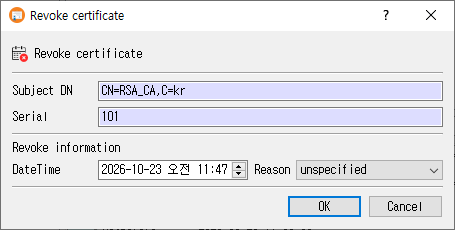

# Revoke Certificate Dialog Guide

This guide explains the **Revoke certificate** dialog. Select a certificate in the main window and choose **Revoke Certificate** from the context menu or **Tools > Revoke Certificate** (`Shift+F10`). A database connection is required.

## Revoke a certificate

1. Confirm the read-only **Subject DN** and **Serial** shown for the selected certificate.
2. Set the **DateTime** of revocation. It defaults to the current date and time.
3. Choose a **Reason**. The default is `unspecified`.
4. Click **OK** to record the revocation, or **Cancel** to leave without saving.

When confirmed, CertMan adds a revocation record for the selected certificate, changes its status to revoked, and refreshes the issuer's Revoked List. The reason and date are used when a CRL is generated.

## Fields

| Field | Purpose |
|---|---|
| **Subject DN** | Read-only subject distinguished name of the selected certificate. |
| **Serial** | Read-only field labeled Serial. The current dialog populates it with the certificate's database record number; the saved revocation record uses the certificate's actual serial number. |
| **DateTime** | Revocation date and time. Initially set to the current local date and time. |
| **Reason** | Revocation reason recorded for the certificate. |
| **OK** | Save the revocation and update the certificate status. |
| **Cancel** | Close without recording a revocation. |

Available reasons include `unspecified`, `keyCompromise`, `CACompromise`, `affiliationChanged`, `superseded`, `cessationOfOperation`, `certificateHold`, `removeFromCRL`, `holdInstruction`, `keyTime`, and `CAKeyTime`.

## Restrictions

- Select a certificate row before opening the command. The command is unavailable when the current list is not a certificate list.
- A self-signed Root CA certificate cannot be revoked through this command.
- For a CA certificate that is not a self-signed Root CA, revoke carefully: newly generated CRLs for that issuer can publish the revocation.

## Related implementation

This guide is based on `images/revoke_cert_dlg.png`, `src/CertMan/revoke_cert_dlg.ui`, `src/CertMan/revoke_cert_dlg.h`, `src/CertMan/revoke_cert_dlg.cpp`, and the **Revoke Certificate** action in `src/CertMan/mainwindow.cpp`.
