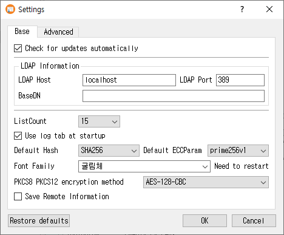

# Settings Manual

The Settings dialog contains general application preferences and configuration for connected services. Settings are organized into tabs. Some service settings are available only in the licensed or PRO editions.

## Open the dialog

Choose **Settings** from the main window.

## Base tab

Use **Base** to configure common behavior and defaults:

- **Check for updates automatically** enables automatic update checks when supported by the build.
- **LDAP Information** sets the LDAP host, port, and BaseDN used by LDAP operations.
- **ListCount** controls the number of rows shown in list views.
- **Server status check** controls the application's server-status checking behavior.
- **Use log tab at startup** opens the log tab on startup.
- **Default Hash** sets the default hash algorithm, and **Default ECCParam** sets the default elliptic-curve parameter where available.
- **Font Family** selects the application font.
- **PKCS8 PKCS12 encryption method** chooses the encryption method used for these private-key/container formats.
- **Save Remote Information** controls whether remote connection information is saved.

## Advanced tab

- **Language** changes the application language. A restart is required for the change to take effect.
- **Show private key value** controls whether private-key values are displayed in the interface.
- **Use PKCS11** enables PKCS#11 integration. Set the **Library Path**, **Slot Index**, and **PIN** as needed. Use **Find** to locate the PKCS#11 library. The slot index identifies the slot position to use.
- **Use fixed hex area / Characters** adjusts the fixed-width hexadecimal display area.

## Service tabs

The other tabs configure connection information for external services. Enable each service's information group before using its settings.

- **KMIP**: host, port, CA certificate, client certificate, private key, username, and password. Use **Find** beside certificate and key paths to browse for files.
- **OCSP**: responder URI and server certificate. **Attach Signature** enables the optional signature attachment and allows signer certificate and private-key paths to be set.
- **CMP**: server URI, root CA certificate, and CA certificate.
- **REG**: registration server URI, administrator name, and password.
- **TSP**: timestamp server URI and server certificate.
- **SCEP**: SCEP URI. **SSL Mutual Auth** enables mutual TLS authentication and its client certificate and private-key paths.

Use the **Find** buttons to select the associated files. These tabs and some Base-tab options may be restricted by the installed edition.

## Save or discard changes

- Click **OK** to save the settings and close the dialog. If the language changed, the application asks whether to restart now.
- Click **Cancel** to close without applying the edits from this dialog.
- Click **Restore defaults** to clear saved settings and return to defaults. Confirm the prompt; the application then offers to restart to apply them.

