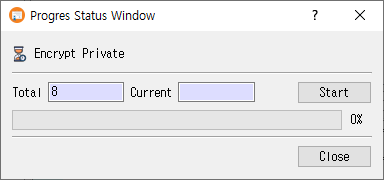

# Set Password Dialog Guide

This guide describes the `SetPassDlg` password prompt used when creating a new CertMan database. It is not the dialog opened by **Data > Set Passwd**: that menu action opens the private-key encryption progress window.

> **Image note:** The supplied `set_pass_dlg.png` shows a **Progress Status Window** with **Encrypt Private**, which does not match the `SetPassDlg` layout in `src/CertMan/set_pass_dlg.ui`. The guide below documents the source dialog; the image is included as provided and should be replaced with a screenshot of the password prompt when one is available.

## When this dialog appears

The main-window **File > New** command (`Ctrl+N`) opens this dialog with the heading **Set private key password** before prompting for a new database location. The dialog collects the password preference; when the database is created, CertMan saves the password verifier and enables private-key encryption only if the application is licensed and **Use password** is selected.

## Set a password

1. Leave **Use password** selected to encrypt internal private keys saved in the new database.
2. Enter a value in **Password** and enter it again in **Password Confirm**.
3. Click **OK** to accept. The values must match.
4. To create the database without this private-key password protection, clear **Use password** and click **OK**. The warning text changes to indicate the unsafe setting.
5. Click **Cancel** to cancel the database creation flow.

When **Use password** is cleared, the password fields are disabled and no password is required. The main window does not store the password configuration in an unlicensed database.

## Fields and controls

| Field or control | Purpose |
|---|---|
| Heading | Set by the calling workflow; for new database creation it reads **Set private key password**. |
| **Use password** | Enable or disable password protection. Checked by default. Some callers can require it and hide the checkbox. |
| Description | Explains that the password encrypts private keys, or warns that the setting is unsafe when password use is disabled. |
| **Password** | New password. Input is masked. |
| **Password Confirm** | Re-enter the password. Input is masked and must match. |
| **OK** | Accept the choice after validation. |
| **Cancel** | Reject the dialog and return to the caller. |

The dialog rejects an empty password, an empty confirmation, or a mismatch when **Use password** is checked. It does not itself encrypt keys; the caller saves the password verifier and subsequent key operations use the configured password.

## Important distinction

The separate **Data > Set Passwd** (`Ctrl+Alt+P`) action requires an open, licensed database with unencrypted private keys. It starts a progress operation to encrypt internal private keys; it does not open `SetPassDlg`. **Data > Change Passwd** similarly uses a progress operation when keys are already encrypted.

## Related implementation

This guide is based on `images/set_pass_dlg.png`, `src/CertMan/set_pass_dlg.ui`, `src/CertMan/set_pass_dlg.h`, `src/CertMan/set_pass_dlg.cpp`, and the **File > New** call site in `src/CertMan/mainwindow.cpp`.
