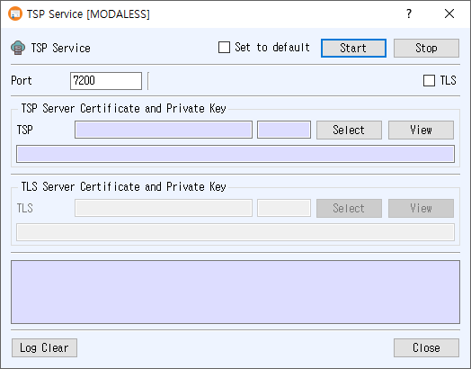

# TSP Service Manual

The TSP Service dialog runs a Time-Stamp Protocol (TSP) server using a selected TSP signing certificate and private key. You can optionally secure its listener with TLS.

## Open the dialog

Choose **Service > TSP Service** from the main window.

## Configure the service

1. Enter the listener **Port**.
2. In **TSP Server Certificate and Private Key**, click **Select** and choose the certificate used to sign timestamp responses. The selected certificate number and name appear in the fields; use **View** to inspect it.
3. To enable encrypted transport, check **TLS**. The **TLS Server Certificate and Private Key** section becomes available. Click its **Select** button to choose the TLS server certificate and associated private key. Use **View** to inspect the selected certificate.
4. Optionally check **Set to default** to save these settings for the next time the dialog opens.
5. Click **Start**. A successful start is indicated by the Start button turning green, and server messages appear in the log.

The TSP signing certificate is required. When TLS is enabled, a TLS certificate and private key are also required. The application reports an error if the port is empty, a selected record or key cannot be loaded, or the server cannot start. TLS certificates backed by PKCS#11 are not supported by this dialog.

## Controls

- **Stop** stops the running TSP server.
- **Log Clear** clears the messages displayed in the log.
- **Close** closes the dialog.
- **Set to default** stores the listener port, TLS setting, and selected certificate numbers as the next-use defaults. Leaving it unchecked clears the saved default when the service starts.

