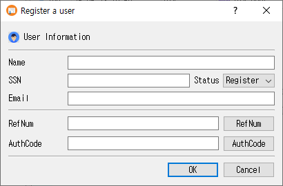

# User Dialog Guide

This guide explains CertMan's **Register a user** dialog. Open it from **Tools > Register User**. A database connection is required. The same dialog can also be opened for an existing user to modify that record.

## Register or update a user in CertMan

1. Enter the user's **Name**, **SSN**, and **Email**. These three fields are required.
2. Choose a **Status**. New dialogs default to **Register**.
3. Optionally enter a **RefNum** and **AuthCode**, or use the buttons beside those fields to generate values.
4. Click **OK** to save the record to the currently connected database. Click **Cancel** to close without saving.

After saving, CertMan refreshes the User list. If the dialog was opened for an existing user, it updates that record; otherwise, it adds a new user record.

## Fields and controls

| Field or control | Purpose |
|---|---|
| **Name** | Required user name. |
| **SSN** | Required SSN value used by the application as the user's identifier. |
| **Email** | Required email address. |
| **Status** | User status. The available values are **Invalid**, **Register**, **Issue**, and **Stop**. New records default to **Register**. |
| **RefNum** | Optional reference number. Click the **RefNum** button to fill the next sequence number based on the latest user record in the database. |
| **AuthCode** | Optional authorization code. Click **AuthCode** to generate a random code and populate the field. |
| **RegServer** | In Pro, submit the user's name, SSN, and email to the configured registration server. |
| **OK** | Save the user record to the local CertMan database, or update the loaded record. |
| **Cancel** | Close without saving changes to the local database. |

## Register with the registration server

The **RegServer** button is available in Pro. It sends the current **Name**, **SSN**, and **Email** to the configured REG server after signing in. A successful response displays a confirmation and refreshes the User list. This is a separate action from clicking **OK**, which saves the local database record. REG server settings and a successful login are required.

## Editing an existing user

When opened for an existing record, the dialog title changes to **Modify a user** and the stored name, SSN, email, authorization code, and reference number are loaded. Change the desired values and click **OK** to update the record. The status selector is initialized to **Register** when the dialog is shown; review it before saving an edit.

## Notes

- The dialog validates that **Name**, **SSN**, and **Email** are not empty. It does not perform additional format validation in this form.
- The **RefNum** and **AuthCode** fields are optional for local saving.
- The **RegServer** button is hidden outside the Pro edition.

## Related implementation

This guide is based on `images/user_dlg.png`, `src/CertMan/user_dlg.ui`, `src/CertMan/user_dlg.h`, `src/CertMan/user_dlg.cpp`, and the **Register User** action in `src/CertMan/mainwindow.cpp`.
